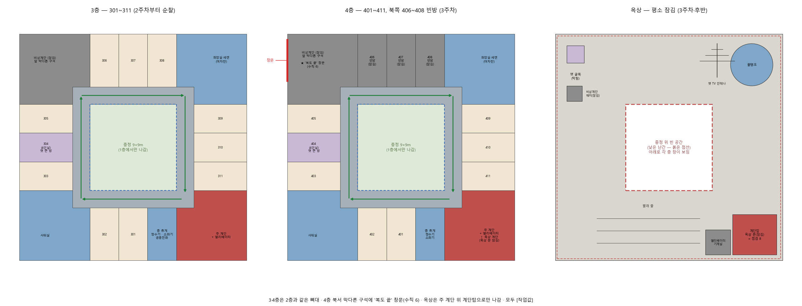

# 별관 건물 구조 — 짓기 전에 정할 것 (2026-11-28)

_사용자: "일단 두고 좀 더 구체적으로 어떻게 만들지 정하고 만들자. 층 건물 구조, 자세한 디테일 같은 것들. 아직 스타일 확정 아니야."_
_상태: 전체 [후보]. 사용자가 고른 것만 [확정]. 숫자는 [작업값]._
_결정: 2026-11-28 건물 모양 = **ㅁ자 중정형 + 원래 기숙사로 지은 건물이 아님** [확정] (§10)._

---

## 0. 이 문서가 다루는 것 / 안 다루는 것
- **다룬다**: 건물 모양, 층마다 무엇이 어디 있나, 크기 기준, 공간마다 놓일 물건, 회차·괴현상에 필요한 구조.
- **안 다룬다**: 보이는 스타일(카툰↔현실, 재질, 조명 색). 스타일은 **미정**이다(look-exploration §10 [후보]). 건물은 실제 치수로 회색 상자부터 짓고, 스타일은 나중에 재질·조명으로 덮는다. 그래서 스타일이 정해지지 않아도 이 문서는 정할 수 있다.
- 회색 상자 판(tech-plan §5-6)은 **여기서 멈춤**. 1~3단계(1인칭·하루 진행기·물건·시험 복도)는 그대로 두고, 4단계부터는 이 문서가 정해진 뒤 진짜 평면으로 다시 짓는다.

## 1. 이미 정해진 것 (다시 묻지 않음)
| 항목 | 내용 | 출처 |
|---|---|---|
| 건물 | 캠퍼스 밖 언덕의 **오래된 별관** "○○관", 여자 기숙사, 사람·인외 반반 [확정] | setting-bible §3 |
| 층 | **1~4층** [확정] + 옥상·지하는 평소 잠김 [후보] | plan §3-2 |
| 1층 | 사감실(순찰 출발·복귀점), 현관·신발장, 식당, 세탁실, 휴게실, 게시판 [후보] | plan §3-2 |
| 2~4층 | 기숙생 방 층마다 8~10개 [작업값], 공용 화장실·샤워실, 층 휴게 공간 | plan §3-2 |
| 순찰 | 사감실 출발 → 한 바퀴 → 사감실 복귀 [확정]. 범위는 주마다 1~2층 → 3층 → 4층·옥상 [후보] | plan §3-1·3-2 |
| 매일 점검 | 현관 잠금 · 복도 불 · 소화기 · 비상구 유도등 · 세탁실 전원 · 휴게실 냉장고 · 방 번호판 · 옥상 문 [후보] | plan §4-1-2 |
| 수칙에 나온 곳 | 각 층 복도 점호 · 세탁실(0~5시 금지) · 4층 복도 끝 창문 · 사감실 내선 전화 | plan §4-1 |
| 배경 제작 | 바꿀 수 있는 **모듈(조각)** 로 짓는다 (괴현상 때문) | map-anomaly §2 |

## 2. 정하는 순서
1. **건물 모양** (§3) ← 지금
2. 층마다 배치 (§4)
3. 크기 기준 (§5)
4. 공간마다 놓일 물건 (§6)
5. 회차·괴현상용 구조 (§7)
6. → 그다음 회색 상자로 1층 + 2층을 실제 평면대로 다시 짓고, 사용자가 걸어 봄

## 3. 건물 모양 — 후보 3개

| 안 | 좋은 점 | 나쁜 점 | 작업량 |
|---|---|---|---|
| A. 일자형 | 가장 단순. 끝까지 한눈에 보여서 8번 출구식 "틀린 것 찾기"가 쉬움. 짓기 쉬움 | "한 바퀴"가 아니라 왕복. 모퉁이가 없어 "안 볼 때 바뀜"을 숨길 곳이 적음. 4개 층이 다 똑같아 보이기 쉬움 | 작음 |
| B. ㄷ자형 | 모퉁이 2개 = 그 너머가 안 보이는 긴장. 안뜰 창으로 맞은편 복도·방이 보임. 계단 2개라 순찰이 한 방향으로 흐름 | A보다 큼 | 중간 |
| **C. ㅁ자 중정형** (추천) | 층마다 **진짜 한 바퀴** — 수칙 "정해진 길로 한 바퀴, 거꾸로 돌지 마십시오"와 그대로 맞음. 모퉁이 4개. 중정 창 너머로 **다른 층·맞은편이 늘 보임**(불 켜진 방, 서 있는 누군가). 길을 잃기 쉬워 "길이 바뀌는" 괴현상과 잘 맞음 | 가장 큼. 방향을 잃기 쉬워 표지(층 번호·방 번호·색 띠)가 꼭 필요 | 큼 — 대신 네 변이 같은 모듈이라 반복으로 줄임 |

- 추천 이유: 이 게임의 밤은 "한 바퀴 도는 순찰"이 뼈대다. ㅁ자는 그 규칙을 건물 모양 자체로 만든다. 거꾸로 돌면 안 된다는 수칙이 그냥 글이 아니라 공간이 된다.
- 한국의 오래된 학교·관공서 건물에 ㅁ자·ㄷ자 중정형이 흔해서 "오래된 별관"에도 어색하지 않다.
- 작업량이 걱정되면 B(ㄷ자)가 중간 답.

## 4. 층마다 배치 초안 [후보] (모양이 정해지면 그림으로 다시)
| 층 | 공간 | 메모 |
|---|---|---|
| 지하 (잠김) | 보일러실 · 창고 · 옛 기숙생 짐 | 후반 사건용. 평소엔 계단참 철문이 잠겨 있음 |
| 1층 | 현관(신발장·우편함·택배 선반·게시판) · **사감실**(현관 바로 옆, 창구로 출입 감시) · 식당 · 세탁실 · 휴게실 · ~~습성 배려 방 1~2개~~ [폐기·대체 — 사용자 11-28 빼기] | 사감실이 현관을 보는 자리 = "누가 들어오고 나갔나"가 아침 업무와 이어짐 |
| 2~4층 | 2인실 8~10개 · 공용 화장실·샤워실 · 층 휴게 공간(소파·정수기) · 소화기 1 · 비상구 유도등 · 층 표시 | 층마다 구조는 같고 **색 띠·소품·사는 사람**이 다름 → 같은 모듈로 짓고 차이로 기억시킴 |
| 4층 | 위와 같음 + **복도 끝 창문**(수칙 6) · 옥상 계단 · ~~둥지 방~~ [폐기·대체] | 마지막 주에 열림 |
| 옥상 (잠김) | 물탱크 · 빨래 줄 · 난간 | 수칙·점검 항목 8. 진엔딩 쪽 |
- 엘리베이터: **없음** 추천 — 오래된 4층 건물이라 자연스럽고, 계단이 공포 공간(층 사이·계단참)이 된다.
- 계단: 1개(ㅁ자) 또는 2개(ㄷ자·일자). 바깥 철제 비상계단은 [후보] — 잠김·열림으로 지름길·탈출 연출.

## 5. 크기 기준 [작업값]
| 항목 | 값 | 이유 |
|---|---|---|
| 층 높이 / 천장 | 3.2m / 2.6m | 오래된 콘크리트 건물 보통 |
| 복도 폭 | 2.2m | 두 사람이 비켜 감. 좁을수록 무섭지만 1인칭 멀미 고려 |
| 2인실 | 폭 4m × 깊이 6m | 침대 2·책상 2·옷장 2 |
| 방문 | 0.9 × 2.1m, 번호판·이름표 | 점검 항목 7 |
| 모듈 칸 | 1m 격자, 복도 한 칸 = 방 하나 폭(4m) | 복도 늘리기·반복 괴현상이 칸 단위로 됨 |
| 걷는 시간 | ㅁ자 한 바퀴 약 70m ≈ 27초(2.6 m/s) · 4개 층 걷기만 약 2분 | 순찰 10~15분 중 나머지는 점검·사건·대화 |

## 6. 공간마다 놓일 물건 (첫 목록) [후보]
_스타일과 상관없이 "무엇이 있나"만. 게임에서 쓰이는 물건은 굵게._

| 공간 | 물건 | 게임에서 |
|---|---|---|
| 사감실 | **책상**(외박 신청서·명부·택배 장부) · **창구** · **열쇠함**(마스터키) · **내선 전화** · **일지 서랍** · 수칙 액자 · 간이침대 · 전기 주전자 · CCTV 모니터 [후보] | 아침 업무 · 일지 = 저장 · 수칙 7(외선 전화) · 안전지대 → 후반 반전 |
| 현관 | **신발장**(방 번호 칸) · **우편함** · **택배 선반** · **게시판**(공지·쪽지) · 출입 명부 · 우산꽂이 | 점검 1(젖은 신발) · 택배 업무 · 쪽지 단서 |
| 식당 | 긴 탁자 · 의자 · 배식대 · 식단표 · 정수기 | 낮에 기숙생 만남 · 흡혈귀 "마지막 손님" |
| 세탁실 | **세탁기 6 · 건조기 2 · 전원 스위치 함** · 빨래 바구니 · 분실물 상자 | 점검 5 · 수칙 4 |
| 매점 (1층 북, 사용자 추가 11-28) | 계산대 · 진열대(과자·컵라면·생필품) · 냉장 음료장 · 컵라면 온수기 · **셔터** · 바깥 **자판기** · 영업시간 안내 | 낮에 기숙생 만남(편의점식 수다·간식 선물) · 밤엔 셔터가 내려가고 자판기 불빛만 [후보] · 사는 물건(건전지·간식 선물)은 [후보] · 누가 지키나는 [후보] |
| 휴게실 | **냉장고** · TV · 소파 · 잡지 · 기숙생 쪽지 | 점검 6 · 쪽지 단서 |
| 복도 | **방문·번호판·이름표** · **천장 불(방마다 1)** · **소화기 1** · **비상구 유도등** · 창(중정 쪽) · 층 표시 · 게시판 | 점호 · 점검 2·3·4·7 · 8번 출구식 이상 |
| 2인실 안 | 침대 2 · 책상 2 · 옷장 2 · 창 1 · 개인 소품(사는 기숙생마다 다름) | 낮 수리·민원 · 점호 대답 |
| 화장실·샤워실 | 칸 · 세면대 거울 · 샤워 부스 · 배수구 | 거울 이상현상(plan 예시) |
| 계단 | 층 번호 · 계단참 창 · 비상등 | "없던 층" · 층 사이 공포 |
| 옥상 문 / 지하 문 | **철문·자물쇠** | 점검 8 · 후반 사건 |

## 7. 회차·괴현상을 위한 구조 조건
1. **같은 모듈을 반복**: 복도 한 칸·방문·불을 똑같이 만들어 끼움 → 복도 늘리기·끝없는 반복(map-anomaly §2)이 됨.
2. **모퉁이 = 바꿔치기 지점**: 플레이어가 안 볼 때 바꾸는 곳. ㅁ자·ㄷ자는 모퉁이가 많아 유리.
3. **잠긴 문으로 범위 조절**: 층 계단 철문·옥상·지하가 잠겨 있다가 날짜마다 열림.
4. **창 너머 시선**: 중정·안뜰 창으로 다른 층이 보임 → 멀리서 보이는 이상(불 켜진 빈방, 창가의 누군가).
5. **표지로 길 찾기**: 층마다 색 띠·층 번호·방 번호. 이상현상이 이 표지를 틀리게 바꿈.

## 8. 사용자에게 물을 것
1. ~~건물 모양~~ → **C ㅁ자 중정 + 원래 기숙사가 아닌 건물 [확정, 사용자 11-28]** (§10)
2. 엘리베이터 없음 — 괜찮은가
3. 층마다 방 수: 8 / 10 [작업값 10]
4. 건물이 지어진 때(물건·구조의 시대감, 스타일과 별개): 1980년대 후반 [후보] — 테라조 바닥·철제 방화문·형광등·나무 방문 같은 "무엇이 있나"만 정함

## 9. 실제 기숙사 건물 조사 (2026-11-28, 사용자: "실제 기숙사 건물 디자인들 찾아봐")
_그림·도면은 저장소에 넣지 않고 링크만 둔다. 한국 옛 기숙사 도면은 공개 자료가 거의 없어 [확인 필요]._

### 9-1. 평면 유형 — 실제로 쓰이는 것
| 유형 | 생김새 | 실제 | 우리 게임에 |
|---|---|---|---|
| **중복도형** | 가운데 복도, 양쪽에 방 | 한국 대학 기숙사에서 가장 흔함 — 거주 밀도를 높이려고 씀 [1]. 미국 "전통형(corridor style)"도 같음, 공용 화장실은 성별로 [2]. "건물 안의 골목길" [3] | 가장 기숙사다움. 후보 A·B·C 모두 방 쪽은 이 형태로 둘 수 있음 |
| **편복도형** | 한쪽만 방, 반대쪽은 창 | 중정·안뜰을 둔 건물에서 흔함 | 후보 C의 안쪽 벽(중정 창) = 편복도 |
| **회로형(고리형)** | 복도가 한 바퀴 이어짐 | 대학 기숙사 평면별 피난 연구에서 **회로형이 가장 안전**(두 방향으로 피할 수 있음) [4] | 후보 C의 근거 — 고리 복도는 실제로도 설계 이유가 있다 |
| **계단실형** | 복도 없이 계단마다 방이 붙음 | 옥스퍼드·케임브리지 옛 칼리지: "복도가 아니라 계단 원칙", 계단에 글자, 방 주소는 "D3"처럼 [5][6] | 방 번호 체계 아이디어 — 계단 글자 + 번호가 바뀌는 이상현상 |
| **중정·쿼드형** | 건물이 마당을 둘러쌈 | 영국 대학에서 시작, 계단 입구들이 쿼드를 감쌈 [7] · 코펜하겐 원형 중정 기숙사 [3] · 이화여대 기숙사 신관도 블록 사이 쿼드 같은 공간 [8] | 중정 창 너머 시선(§7-4) |
| 스위트·아파트형 | 방 몇 개 + 거실 + 전용 욕실 | 요즘 신축 [2] | 오래된 별관과 안 맞음 → 쓰지 않음 |

### 9-2. 사례에서 가져올 디테일
| 사례 | 무엇 | 가져올 것 |
|---|---|---|
| 교토대 **요시다료** (1913, 목조) | 일본에서 가장 오래된, 아직 쓰이는 학생 기숙사. 식당은 1889년. 세 동이 E자 배치 · 내진 문제로 1982년부터 퇴거 요구, 학생들이 버팀 [9][10][11] | "오래된 별관"의 결: 낡았지만 사람이 사는 곳, 나가라는데 안 나가는 사람들 |
| 요시다료 동관 | 1959~60년에 **노동자 숙소를 기숙사로 바꿈** [10] | 별관이 **원래 다른 용도였던 건물**일 수 있다 [후보, 조각만] — ㅁ자처럼 기숙사답지 않은 모양도 자연스러워짐 |
| 이화여대 **빌링슬리관** (1959~1998) | 600~700명, "한국 대학 최초 현대식 기숙사" [12] | 한국 여자 기숙사의 시대감 기준점(80~90년대에도 쓰인 50년대 건물) |
| 1960년대 미국 **여자 기숙사** | 열쇠는 하우스마더만, 밤·주말에 나갈 때 서명하고 들어오면 서명 [13][14] | 우리 사감 업무와 같음: **열쇠함 · 외출·외박 서명부 · 문 잠그는 시각** |
| 미주리대 **Gentry Hall** (1944 여자 기숙사) | "남자는 위층에 못 올라감" · 그래서 **2층에는 지금도 남자 화장실이 없음** [15] | 남자 사감 설정과 딱 맞음: 위층은 점호·순찰 때만 올라감 · 2~4층에 남자 화장실 없음 · 사감 화장실은 1층 사감실 옆 |
| Emory **Harris Hall** (1953 여자 기숙사) | T자 평면, 양쪽 방 복도 [16] | T자도 후보로 둘 수 있음(모퉁이 1개) |
| 한국 1980년대 대학 기숙사 | 한 방 3~4명 숙박 위주 → **80년대 후반부터 2인실이 늘어남** · 층별 공용 세면·화장실은 옛 방식(신축은 방 안 화장실) [17] | 1980년대 후반 건물이면 **2인실 + 층별 공용 화장실·샤워실**이 자연스러움 (§4와 같음). 4인실 몇 개를 섞으면 "옛 방을 2인실로 고친" 흔적 |

### 9-3. 치수 참고
- 방 한 칸 사례(최근 기숙사): **2.6 × 5.6m(18.7㎡)**, 샤워·세면실과 화장실 각 1.15 × 2m [17] → §5의 4 × 6m는 넉넉한 편. 오래된 2인실이면 **3 × 5.5m** 정도로 줄여도 됨 [작업값 후보].
- 복도: 양옆에 방이 있는 복도는 1.8m 이상 기준이 있음(생활숙박시설·공동주택 쪽 규정, 기숙사에 그대로 적용되는지는 [확인 필요]) [18] → §5의 2.2m는 실제보다 조금 넓음. **1.8~2.0m**로 줄이면 더 답답하고 무서움 [작업값 후보]. 1인칭 멀미는 걸어 보고 판단.
- 한 복도에 25~30명이 "너무 시설 같지도, 외롭지도 않은" 크기였다는 설계 사례 [3] → 2인실 12~15개. 우리 10개(20명)는 조금 작고 아늑한 쪽.

### 9-4. 조사로 바뀌는 추천
1. **실제로 ㅁ자 중정 기숙사는 드물다** — 한국 대학 기숙사는 거의 중복도 일자·ㄱ자다(검색에서 ㅁ자 기숙사 사례를 못 찾음). 대신 학교·관공서·옛 병원에 ㅁ자가 흔하다.
2. 그래서 C(ㅁ자)를 고른다면 **"원래 기숙사로 지은 건물이 아니다"** 쪽이 자연스럽다. 무엇이었는지는 말하지 않고 조각만 준다(setting-bible §4): 막힌 배식구, 번호가 다른 옛 문패, 쓰지 않는 방 하나.
3. 실제 느낌을 가장 살리려면 **B'(ㄷ자) 또는 C를 쓰되 방 쪽은 중복도로** — 바깥 날개는 양쪽에 방(중복도), 중정 쪽 날개는 한쪽 방·한쪽 창(편복도).
4. 확실히 가져올 디테일: 사감실 열쇠함·외출 서명부·문 잠그는 시각 · 위층에 남자 화장실 없음 · 2인실 + 층별 공용 화장실 · 계단 글자 + 방 번호 주소.

### 출처
1. [호남권 대학 기숙사 10개 조사(중복도 형태), koreascience](https://koreascience.kr/article/JAKO200730360545501.pdf)
2. [Cornell — Residence Hall Configurations](https://scl.cornell.edu/sub/sub/residential-life/housing/housing-details/residence-hall-configurations)
3. [Dwell — Back To School Special](https://www.dwell.com/article/back-to-school-special-0b6aad38)
4. [대학 기숙사의 평면 형태에 따른 피난 안전성 검토(2010), koreascience](https://koreascience.kr/article/JAKO201013351025493.page)
5. [Emmanuel College — staircase principle](https://www.emma.cam.ac.uk/members/blog/?id=500)
6. [Queens' College — Staircase letters](https://history.queens.cam.ac.uk/college/buildings/staircase-letters)
7. [Spaces4Learning — Models for Undergraduate Housing](https://spaces4learning.com/Articles/2007/08/01/Theres-No-Place-Like-Home-Models-for-Undergraduate-Housing.aspx)
8. [VMSPACE — 이화여대 기숙사](https://vmspace.com/report/report_view.html?base_seq=MTQy)
9. [Wikipedia — Yoshida dormitory](https://en.wikipedia.org/wiki/Yoshida_dormitory,_Kyoto_University)
10. [Japanese Wiki Corpus — 京都大学吉田寮](https://japanese-wiki-corpus.github.io/history/Yoshida%20dormitory%20of%20Kyoto%20University.html)
11. [Kyoto University 공지(2018)](https://www.kyoto-u.ac.jp/en/news/2018-02-02-4)
12. [이화여대 기숙사 연혁](https://dmtry.ewha.ac.kr/engdorm/history.do)
13. [On Wisconsin — Campus History](https://onwisconsin.uwalumni.com/?p=25709)
14. [History Nebraska — Dress Codes & Curfews](https://history.nebraska.gov/dress-codes-curfews-nu-women-in-the-1960s/)
15. [Mizzou CAFNR — No Men Upstairs](https://cafnr.missouri.edu/stories/no-men-upstairs)
16. [Emory — Harris Hall](https://storymaps.arcgis.com/stories/a6e307a900354611ad4d0ac009436f1e)
17. [대학 기숙사 단위공간 연구(2016), koreascience](https://koreascience.or.kr/article/JAKO201630765903642.pdf)
18. [건축물방화구조규칙 제15조의2 복도 너비 유권해석](https://www.nepla.ai/wiki/국토와-건설-부동산/건설-건축-주거환경/-유권해석-건축물의-피난-방화구조-등의-기준에-관한-규칙-제15조의2-복도의-너비-및-설치기준-w5dnz320y8e6)

## 10. 평면 초안 — ㅁ자 중정 + 원래 다른 건물 (2026-11-28)
**사용자 결정 [확정]:** 건물 모양 C(ㅁ자 중정) + "원래 기숙사로 지은 건물이 아니다". 이유: 수칙 "정해진 길로 한 바퀴, 거꾸로 돌지 마십시오"가 공간이 되고, 실제로 ㅁ자 기숙사는 드물어서(§9-4) 다른 용도였던 건물을 고쳐 쓴 쪽이 자연스럽다.
**원래 무엇이었나는 정하지 않는다**(setting-bible §4). 게임에는 흔적 조각만: 막힌 배식구, 번호 체계가 다른 옛 문패, 2인실 사이 혼자 큰 4인실, 비상계단 앞 막다른 구석.

_그림 만드는 스크립트: `tools/dev/building_plan.py` (값 바꾸고 다시 그림)_

### 10-1. 뼈대 [작업값] — 크기는 §11에서 바뀜(방 3×5.5m · 복도 1.8m · 바깥 23.6m · 중정 9m)
| 항목 | 값 |
|---|---|
| 바깥 크기 | 27 × 27m, 4층 + 지하(잠김) + 옥상(잠김) |
| 중정 | 12 × 12m. 1층에서만 나갈 수 있음. 위층에서는 창으로만 봄 |
| 날개 | 깊이 7.5m = 방 5.5m + 복도 2.0m. **편복도** — 방은 바깥쪽, 복도는 중정 쪽(복도에서 늘 중정 창이 보임) |
| 방 한 칸 | 4 × 5.5m (2인실). 날개마다 가운데 3칸 + 모서리 4개 |
| 복도 한 바퀴 | 가운데 선 기준 약 56m ≈ 22초 (2.6 m/s) |
| 계단 | **주 계단 1개**(남동 모서리, 사감실 옆) + **비상계단 1개**(북서 모서리, 평소 잠김 — 후반에 열림) |
| 엘리베이터 | ~~없음~~ → **있음** [확정, §11] |
| 방위 | 남쪽 = 현관. 날개 이름 남·서·북·동 |

### 10-2. 1층 — 사감실에서 출발·복귀
| 자리 | 공간 | 게임에서 |
|---|---|---|
| 남 가운데 | **현관 홀**(게시판) | 점검 1 현관 잠금 |
| 남 동쪽 | **사감실** — 창구가 현관 홀을 봄, 바로 옆이 주 계단 | 아침 업무 · 순찰 출발·복귀 · 안전지대 |
| 남 서쪽 | 택배·우편실 + 신발장 | 택배 업무 · 젖은 신발 |
| 남서 모서리 | 공용 화장실 + **사감 화장실**(건물에서 남자 화장실은 여기 하나, §9-2 Gentry Hall) | — |
| 서 날개 | **독서실**(공부방, 수조 방 대신 — §13) · 창고 · **번호가 다른 옛 문패 방(잠김)** | 옛 건물 흔적 |
| 북서 모서리 | **비상계단(잠김) + 지하로 가는 철문** | 후반 사건 |
| 북 날개 | 세탁실 · 휴게실(냉장고·TV) · **매점**(사용자 추가 11-28, 휴게실 옆) | 점검 5·6 · 수칙 4 · 매점은 아래 |
| 북동 모서리 | 주방 · 식료품 창고 | — |
| 동 날개 | 식당 2칸 · **옛 배식구(막힘)** | 낮 만남 · 옛 건물 흔적 |

- 매점: 1층 북 날개, 휴게실 바로 옆. 원래 2칸이던 휴게실을 1칸으로 줄여 넣음. 밤 셔터·자판기 불빛은 순찰 때 1층 북쪽의 "늘 같은 풍경"이 되고, 그게 달라지면 이상현상 재료(셔터가 반쯤 올라가 있음, 자판기가 혼자 떨어뜨림) [후보].

### 10-3. 2~4층 — 같은 뼈대
- 방 번호 = **순찰 순서**: 주 계단에서 나와 시계 방향으로 201 → 211. 남 날개 202·201 → 서 날개 203·**204(4인실, 옛 큰 방)**·205 → 북 날개 206·207·208 → 동 날개 209·210·211.
- 남 날개 계단 옆: **층 휴게**(정수기·소화기 = 점검 3) · 남서 모서리: 샤워실 · 북동 모서리: 화장실·세면(여자 화장실만).
- 북서 모서리: **비상계단 앞 막다른 구석**. 고리 복도에서 유일하게 막힌 곳.
- 층마다 2인실 10 + 4인실 1 = 24명. 3개 층이면 72명 [작업값]. 명단 27명 + 엑스트라 20~30명보다 넉넉함 → **빈방이 생긴다**(점호·이상현상 재료). 줄이려면 4층 일부를 잠금.
- 층마다 다른 것(같은 모듈로 짓고 이걸로 기억시킴): 층 색 띠, 층 휴게 소품, 사는 사람, 게시판 내용.

### 10-4. 순찰 길
사감실 → 1층 한 바퀴(현관·세탁실·휴게실·소화기·유도등) → 주 계단 → 2층 한 바퀴 → 3층 → 4층 → 계단 끝 **옥상 문** 점검 → 주 계단으로 내려와 사감실.
- 모든 층에서 **시계 방향** [작업값]. 거꾸로 돌면 수칙 위반.
- 범위는 주마다 늘어남(1주 = 1·2층, 2주 = 3층, 3주 = 4층·옥상). 안 열린 층은 계단참 철문이 잠겨 있음.

### 10-5. 수칙과 맞추기
- 수칙 6 "4층 **복도 끝** 창문" — 고리 복도에는 끝이 없다. → **4층 북서 막다른 구석의 창문**으로 둔다. "끝이 없는 복도에 '끝'이 있다"는 것 자체가 이상하게 읽힘. 수칙 글은 그대로 [작업값].
- 수칙 순찰 1 "정해진 길로 한 바퀴, 거꾸로 돌지 마십시오" = 시계 방향 고리.
- 중정 쪽 창 = 늘 다른 층·맞은편이 보이는 곳. 밤에 **불 켜진 빈방**, **맞은편 복도에 서 있는 누군가**, 내가 지나온 자리의 변화.

### 10-6. 아직 정할 것
1. 엘리베이터 없음 — 확인
2. 방 크기 4 × 5.5m vs 조사 기준으로 줄인 3 × 5.5m (줄이면 날개마다 4칸, 방 수 늘어남)
3. 복도 2.0m vs 1.8m
4. 지어진 때·고쳐 쓴 때(물건의 시대감): 원래 건물 1960~70년대, 기숙사로 고친 때 1980년대 후반 [후보]
5. 3·4층 평면 차이(4층 막다른 창문 외에), 지하·옥상 평면
6. → 정해지면 공간별 물건 목록(§6)을 이 평면에 맞춰 다듬고, 회색 상자로 1·2층을 실제 평면대로 지음

## 11. 사용자 결정 반영 (2026-11-28 2차)
사용자: "매점 알바생 하나 추가, 간단한 물건 구매 가능 · 엘리베이터 넣기 · 시대감 80·90년대 일단 · 지하는 평소에는 잠겨 있게, 의문의 공간 느낌으로 · 크기·폭은 추천안"

| 항목 | 결정 | 상태 |
|---|---|---|
| 매점 | **알바생 1명**이 지킴 · **간단한 물건을 살 수 있음** | [확정] |
| 엘리베이터 | **있음** — 주 계단 옆(남동 모서리) | [확정] |
| 시대감 | **1980~90년대** (물건·설비·글씨체의 시대) | [작업값 — 사용자 "일단"] |
| 지하 | **평소 잠김, 의문의 공간.** 무엇이 있는지 정하지 않음 | [확정 방향] |
| 크기·폭 | 추천안: **방 3 × 5.5m · 복도 1.8m** | [작업값] |

### 11-1. 크기 추천안 — 왜 이렇게
- 실제 기숙사 방은 2.6~3m 폭이 보통(§9-3) → **방 3 × 5.5m**. 복도는 양옆 거실 복도 기준 1.8m → **1.8m**(더 답답하고 무서움, 멀미는 걸어 보고 판단).
- 방이 좁아진 만큼 **건물을 줄여** 층마다 방 수(2인실 10 + 4인실 1)는 그대로: 날개 가운데 3칸 × 3m = 9m.
- 결과: 바깥 **23.6 × 23.6m**, 중정 **9 × 9m**, 날개 깊이 7.3m, 복도 한 바퀴 약 **43m ≈ 17초**(2.6 m/s).
- 중정이 9m로 좁아져 **맞은편 복도의 얼굴·창이 더 또렷하게 보임** — 중정 너머 시선(§7-4)이 더 강해짐.
- 값은 `tools/dev/building_plan.py` 위쪽 숫자만 바꾸면 다시 그려짐.

### 11-2. 엘리베이터 [후보 — 쓰임새]
- 자리: 남동 모서리, 주 계단 옆. 1층에서는 사감실·현관 바로 곁.
- 80~90년대 소형 승강기: 좁은 칸, 층 버튼 B·1·2·3·4·R(옥상은 표시만). **B 버튼은 열쇠 구멍으로 막혀 있음.**
- 낮: 기숙생이 타고 내림(만남 장소, 짐 든 기숙생). 사감도 탈 수 있음.
- 밤 순찰: **계단으로 돈다** [작업값] — 수칙에 "순찰 중 엘리베이터를 타지 마십시오"를 넣을지 [후보].
- 이상현상 재료 [후보]: 아무도 없는데 층 표시가 움직임 · 혼자 1층에 내려와 문이 열림 · **B에 불이 들어옴** · 거울에 비친 칸 안 인원이 다름.

### 11-3. 지하 — 의문의 공간 [확정 방향]
- 들어가는 길 두 개, 둘 다 잠김: **엘리베이터 B 버튼(열쇠)** · **북서 비상계단 아래 철문**.
- 사감 열쇠함에 **맞는 열쇠가 없다** [후보]. 무엇이 있는지·왜 잠겼는지는 정하지 않는다(setting-bible §4). 보여 주는 것은 조각만: 철문 너머 소리, 엘리베이터 B 불빛, 옛 도면에 지하가 그려져 있지 않음 [후보].
- 평면은 그리지 않는다(정해지면 그림).

### 11-4. 매점과 알바생 [확정 + 세부 후보]
- **알바생 1명** — 기숙생이 아님(바깥에서 출근). 건물 안에서 사감 말고 유일하게 "여기 속하지 않는 사람"이 하나 더 있는 셈 → 낮의 안심 역할, 또는 그 반대 [후보].
- 사람인지 인외인지, 이름·성격·관계는 [후보] — 캐릭터 정할 때 같이.
- 영업: 낮~저녁 [작업값 08:00~22:00]. 밤엔 셔터, 자판기 불빛만.
- **살 수 있는 것** [작업값]: 건전지(손전등) · 간식·음료(기숙생 선물 = 호감) · 컵라면 · 생필품(수리 소모품: 전구·테이프 등은 [후보]). 돈은 사감 월급에서 [작업값].
- 게임에서: 낮 행동 칸을 쓰지 않는 짧은 들르기 [후보] · 알바생이 흘리는 소문(단서) [후보].

### 11-5. 시대감 1980~90년대 [작업값] — "무엇이 있나"만 (스타일 아님)
| 곳 | 물건 |
|---|---|
| 바닥·벽 | 테라조(인조석) 바닥 · 허리 높이까지 칠한 벽(아래 진한색, 위 밝은색) · 녹색 칠판식 게시판 |
| 불·설비 | 형광등(긴 막대) · 둥근 벽시계 · 스위치가 줄지어 붙은 배전반 · 라디에이터 |
| 문·창 | 나무 방문 + 플라스틱 번호판 · 철제 방화문 · 미닫이 알루미늄 창 |
| 사감실 | 회색 철제 책상 · 다이얼 또는 버튼식 **내선 전화** · 장부·명부(손글씨) · 열쇠함 · 브라운관 TV / CCTV 모니터 [후보] |
| 매점·휴게 | 유리문 냉장 음료장 · 동전 자판기 · 브라운관 TV · 공중전화 [후보] |
| 글씨 | 손글씨 공지 · 타자기·도트 프린터 인쇄 수칙 |
- 원래 건물은 그보다 오래됨(무엇이었는지는 조각만) — 옛 문패·막힌 배식구는 다른 시대의 글씨·재질로.

### 11-6. 남은 것
1. 3·4층 평면 차이(4층 막다른 창문 외에) · 옥상 평면
2. 공간별 물건(§6)을 새 평면·시대감에 맞춰 다듬기
3. → 회색 상자로 1·2층 + 엘리베이터 + 계단을 실제 평면대로 짓고 사용자가 걸어 봄

## 12. 1층 변경안 — 매점 키우기 · 식당 빼기 (2026-11-28, 사용자 질문) [폐기·대체 → §14]
사용자: "매점이 너무 작지 않나 · 수조 방은 뭐야 · 주방이랑 식당이 보통 기숙사 안에 있나? 학교 건물에 있지 않아?"

- **매점**: 지금 3 × 5.5m(약 5평)은 작음 → 변경안 **2칸 6 × 5.5m(약 10평)**, 동 날개 남쪽(주 계단·현관 쪽, 바깥에서 출근하는 알바생 동선과 맞음).
- **식당**: 실제로는 기숙사 식당이 **따로 떨어진 식당동**에 있거나(아주대 "기숙사 식당동" [1]), 생활관 안에는 **공용 주방·취사실**만 두는 경우가 많다(아주대 각 관 취사실 [2], 서울대 생활관 공용주방 [3]). 캠퍼스 밖 70명짜리 별관이 식당을 따로 운영하는 건 어색 → 변경안: **식당 없음**, 식사는 캠퍼스 식당·매점·**공용 취사실**(라면·간단 조리, 북동 모서리).
- 대신 **원래 건물의 식당은 막힌 채 남는다**(동 날개 북쪽 "옛 식당 + 배식구") — "원래 다른 건물" 흔적이 더 커짐.
- 휴게실은 다시 2칸(냉장고 / TV·소파).
- ~~**수조 방**~~ [폐기·대체 — §13]: setting-bible §3의 "종족 습성 배려 시설"(암실·수조 방·둥지 방) 중 하나. 물에서 지내야 하는 인외(인어·물 종족·슬라임 계열 후보)를 위한 큰 욕조·수조가 있는 방. 물이 무거워 1층에 둠. **물 종족 기숙생이 명단에 들어가면 남기고, 아니면 빼거나 다른 습성 방(암실 등)으로** [후보].

출처: [1] [아주대 생활관 시설](https://ajou.ac.kr/dorm/tendinous/policy001.do) · [2] [아주대 남제관 시설](https://ajou.ac.kr/dorm/tendinous/facilities_namjae.do) · [3] [서울대 생활관 안내(PDF)](https://architecture.snu.ac.kr/wp-content/uploads/2024/12/20241204_041745.pdf)

## 13. 종족 습성 배려 시설 빼기 (2026-11-28, 사용자) [확정]
사용자: "종족 습성 배려 시설은 빼."
- 수조 방·암실·둥지 방 같은 **종족 전용 시설은 건물에 없다.** 1층 서 날개의 수조 방 자리는 **독서실(공부방)** [작업값] — 실제 기숙사에 흔한 공간.
- 방 안의 개인 소품은 사는 기숙생마다 다를 수 있음(시설이 아니라 짐).
- setting-bible의 "습성 배려 시설이 별관에만 있어 인외 비율이 높다"·"종족 습성 배려법(햇빛 차단 방·수조 방 등)"도 [폐기·대체]. 별관 이유(겉)는 자리 부족·싼 기숙사비만 남음.
- 평면 그림 두 장 다시 그림(`plan_1f_2f.png`, `plan_1f_v2.png`).

## 14. 1층 3차 (2026-11-28, 사용자) [확정 방향 · 크기는 작업값]
사용자: "취사실이랑 휴게실을 합치고, 세탁실이랑 매점이 작지 않나, 독서실이랑 창고 합쳐서 그냥 창고로."

| 공간 | 자리 | 넓이 [작업값] | 메모 |
|---|---|---|---|
| **매점** | 동 날개 3칸 전체 | 9 × 5.5m ≈ 50㎡ (약 15평) | 알바생 1 · 계산대 · 진열대 · 음료장. 원래 건물의 식당 자리라 **안쪽 벽에 막힌 옛 배식구**가 남음. 밤엔 셔터 |
| **세탁실** | 북 날개 2칸 | 6 × 5.5m ≈ 33㎡ (약 10평) | 세탁기 6 · 건조기 2 · 전원 스위치 함 (점검 5 · 수칙 4) |
| **휴게실 · 취사실** (합침) | 북동 모서리 + 북 날개 1칸 | ≈ 66㎡ (약 20평) | TV · 소파 · 냉장고(점검 6) · 싱크 · 전자레인지 · 라면 조리. 식당 없음 — 식사는 캠퍼스 식당·매점·여기 |
| **창고** (독서실 합침) | 서 날개 2칸 | 6 × 5.5m ≈ 33㎡ | 독서실은 없앰 |
| 그대로 | — | — | 현관 홀 · 사감실(창구) · 택배·우편실 · 공용/사감 화장실 · 주 계단 + 엘리베이터 · 옛 문패 방(잠김) · 비상계단 + 지하 철문(잠김) |

- 옛 흔적은 이제 1층에 둘: **매점 안 막힌 배식구**, **번호가 다른 옛 문패 방**. (식당 칸은 매점이 됨)
- 그림 스크립트에 "칸 합치기"를 넣음(`tools/dev/building_plan.py` — 칸에 숫자를 주면 여러 칸을 한 방으로).

### 14-1. 다시 확인해 본 것
- **사감실이 3 × 5.5m(약 5평)** — 책상·열쇠함·간이침대·창구가 다 들어가기엔 빠듯함. 실제 사감실은 옆에 숙직실이 붙는 경우가 많음 → 택배·우편실을 줄이거나 사감실을 2칸으로 할지 [확인 필요].
- 현관 홀 3m 폭 — 신발장·게시판·우편함이 같이 있으면 좁음. 신발장은 택배·우편실 쪽으로 이미 뺐음.
- 2층 샤워실·화장실(모서리 약 50㎡씩)은 층 24명에 충분.

## 15. 사감실 2칸 (2026-11-28, 사용자: "2칸으로 넓혀") [확정 · 크기는 작업값]
- **사감실 = 남 날개 2칸(6 × 5.5m ≈ 33㎡, 약 10평)**: 책상 · 창구(서쪽 벽 → 현관 홀) · 열쇠함 · **택배 보관 선반** · 숙직 간이침대 · 내선 전화 · 일지 서랍.
- 자리를 내려고 **현관 홀을 남 날개 서쪽 칸으로 옮김**(바깥문도 같이). 현관 홀에 신발장 · 우편함 · 게시판.
- **택배·우편실은 없앰** → 택배는 사감실 안 선반에 둠(아침 택배 업무가 사감실 안에서 끝남). 우편함은 현관 홀.
- 사감실 동쪽은 바로 주 계단·엘리베이터 → 순찰 출발·복귀가 사감실 문 앞에서 이어짐.

## 16. 3층 · 4층 · 옥상 (2026-11-28) [작업값 · 쓰임새는 후보]

### 16-1. 3층 — 301~311 (2주차부터 순찰)
- 2층과 같은 뼈대. 304 = 4인실(옛 큰 방).
- 층 휴게에 **공중전화**(80~90년대) [후보].
- 기숙생 규칙 "3층 복도 불이 혼자 꺼지면, 다시 켜지 마"(plan §4-1)의 무대 → 3층 복도 불은 다른 층과 같은 모양이어야 "하나만 꺼짐"이 보임.

### 16-2. 4층 — 401~411 (3주차부터)
- **북 날개 406·407·408 = 빈방(잠김)** [작업값]. 사람 수: 2층 24 + 3층 24 + 4층 18 = 66명 자리 → 명단 27 + 엑스트라 20~30명보다 넉넉 → 빈방이 이상현상 재료(불 켜진 빈방, 빈방에서 대답).
- **북서 막다른 구석 바깥벽에 "복도 끝" 창문**(수칙 6, §10-5). 고리 복도에서 유일하게 끝이 있는 곳.
- 주 계단은 4층 위로 한 층 더 올라가 **계단탑 → 옥상 문(잠김)** = 점검 8.

### 16-3. 옥상 — 평소 잠김 (3주차·후반)
| 물건 | 자리 | 게임에서 |
|---|---|---|
| **계단탑 + 옥상 문** | 남동(주 계단 위) | 점검 8 "잠겨 있는데 안쪽에서 두드림" — 옥상으로 나가는 유일한 문 |
| 엘리베이터 기계실 | 계단탑 옆 | 밤에 혼자 도는 소리 [후보] |
| **낮은 난간** | 바깥 둘레 + **중정 둘레** | 중정 위에서 아래를 내려다보면 각 층 복도 창이 보임 |
| 물탱크 | 북동 | — |
| 빨래 줄 | 남 날개 지붕 | 밤에 걸린 빨래 [후보] |
| **옛 굴뚝(막힘)** | 북서 | 원래 건물 흔적. 지하와 이어지는지는 말하지 않음(조각만) |
| 비상계단 꼭대기 해치(잠김) | 북서 | 비상계단이 옥상까지 닿아 있다는 것만 보여 줌 |
| 옛 TV 안테나 | 북 날개 지붕 | 시대감 |

### 16-4. 엘리베이터와 층 [후보]
- 버튼: B · 1 · 2 · 3 · 4 (옥상은 계단으로만). B는 열쇠로 막힘(§11-2).
- plan의 "없는 층 버튼" 아이디어는 이 건물에선 **5층 버튼**으로: 4층 건물 엘리베이터에 어느 날 5층 버튼이 생김.

### 16-5. 남은 것
1. 공간별 물건(§6)을 1~4층·옥상 평면에 맞춰 다듬기 (스타일과 별개)
2. → 회색 상자로 1·2층 + 계단·엘리베이터를 실제 평면대로 짓고 사용자가 걸어 봄
