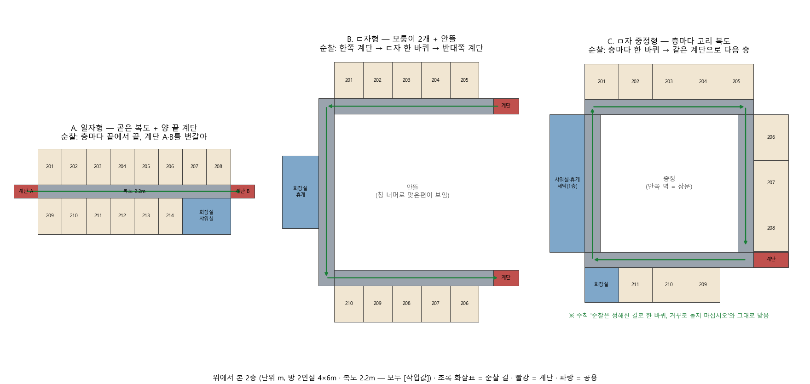

# 별관 건물 구조 — 짓기 전에 정할 것 (2026-11-28)

_사용자: "일단 두고 좀 더 구체적으로 어떻게 만들지 정하고 만들자. 층 건물 구조, 자세한 디테일 같은 것들. 아직 스타일 확정 아니야."_
_상태: 전체 [후보]. 사용자가 고른 것만 [확정]. 숫자는 [작업값]._

---

## 0. 이 문서가 다루는 것 / 안 다루는 것
- **다룬다**: 건물 모양, 층마다 무엇이 어디 있나, 크기 기준, 공간마다 놓일 물건, 회차·괴현상에 필요한 구조.
- **안 다룬다**: 보이는 스타일(카툰↔현실, 재질, 조명 색). 스타일은 **미정**이다(look-exploration §10 [후보]). 건물은 실제 치수로 회색 상자부터 짓고, 스타일은 나중에 재질·조명으로 덮는다. 그래서 스타일이 정해지지 않아도 이 문서는 정할 수 있다.
- 회색 상자 판(tech-plan §5-6)은 **여기서 멈춤**. 1~3단계(1인칭·하루 진행기·물건·시험 복도)는 그대로 두고, 4단계부터는 이 문서가 정해진 뒤 진짜 평면으로 다시 짓는다.

## 1. 이미 정해진 것 (다시 묻지 않음)
| 항목 | 내용 | 출처 |
|---|---|---|
| 건물 | 캠퍼스 밖 언덕의 **오래된 별관** "○○관", 여자 기숙사, 사람·인외 반반 [확정] | setting-bible §3 |
| 층 | **1~4층** [확정] + 옥상·지하는 평소 잠김 [후보] | plan §3-2 |
| 1층 | 사감실(순찰 출발·복귀점), 현관·신발장, 식당, 세탁실, 휴게실, 게시판 [후보] | plan §3-2 |
| 2~4층 | 기숙생 방 층마다 8~10개 [작업값], 공용 화장실·샤워실, 층 휴게 공간 | plan §3-2 |
| 순찰 | 사감실 출발 → 한 바퀴 → 사감실 복귀 [확정]. 범위는 주마다 1~2층 → 3층 → 4층·옥상 [후보] | plan §3-1·3-2 |
| 매일 점검 | 현관 잠금 · 복도 불 · 소화기 · 비상구 유도등 · 세탁실 전원 · 휴게실 냉장고 · 방 번호판 · 옥상 문 [후보] | plan §4-1-2 |
| 수칙에 나온 곳 | 각 층 복도 점호 · 세탁실(0~5시 금지) · 4층 복도 끝 창문 · 사감실 내선 전화 | plan §4-1 |
| 배경 제작 | 바꿀 수 있는 **모듈(조각)** 로 짓는다 (괴현상 때문) | map-anomaly §2 |

## 2. 정하는 순서
1. **건물 모양** (§3) ← 지금
2. 층마다 배치 (§4)
3. 크기 기준 (§5)
4. 공간마다 놓일 물건 (§6)
5. 회차·괴현상용 구조 (§7)
6. → 그다음 회색 상자로 1층 + 2층을 실제 평면대로 다시 짓고, 사용자가 걸어 봄

## 3. 건물 모양 — 후보 3개

| 안 | 좋은 점 | 나쁜 점 | 작업량 |
|---|---|---|---|
| A. 일자형 | 가장 단순. 끝까지 한눈에 보여서 8번 출구식 "틀린 것 찾기"가 쉬움. 짓기 쉬움 | "한 바퀴"가 아니라 왕복. 모퉁이가 없어 "안 볼 때 바뀜"을 숨길 곳이 적음. 4개 층이 다 똑같아 보이기 쉬움 | 작음 |
| B. ㄷ자형 | 모퉁이 2개 = 그 너머가 안 보이는 긴장. 안뜰 창으로 맞은편 복도·방이 보임. 계단 2개라 순찰이 한 방향으로 흐름 | A보다 큼 | 중간 |
| **C. ㅁ자 중정형** (추천) | 층마다 **진짜 한 바퀴** — 수칙 "정해진 길로 한 바퀴, 거꾸로 돌지 마십시오"와 그대로 맞음. 모퉁이 4개. 중정 창 너머로 **다른 층·맞은편이 늘 보임**(불 켜진 방, 서 있는 누군가). 길을 잃기 쉬워 "길이 바뀌는" 괴현상과 잘 맞음 | 가장 큼. 방향을 잃기 쉬워 표지(층 번호·방 번호·색 띠)가 꼭 필요 | 큼 — 대신 네 변이 같은 모듈이라 반복으로 줄임 |

- 추천 이유: 이 게임의 밤은 "한 바퀴 도는 순찰"이 뼈대다. ㅁ자는 그 규칙을 건물 모양 자체로 만든다. 거꾸로 돌면 안 된다는 수칙이 그냥 글이 아니라 공간이 된다.
- 한국의 오래된 학교·관공서 건물에 ㅁ자·ㄷ자 중정형이 흔해서 "오래된 별관"에도 어색하지 않다.
- 작업량이 걱정되면 B(ㄷ자)가 중간 답.

## 4. 층마다 배치 초안 [후보] (모양이 정해지면 그림으로 다시)
| 층 | 공간 | 메모 |
|---|---|---|
| 지하 (잠김) | 보일러실 · 창고 · 옛 기숙생 짐 | 후반 사건용. 평소엔 계단참 철문이 잠겨 있음 |
| 1층 | 현관(신발장·우편함·택배 선반·게시판) · **사감실**(현관 바로 옆, 창구로 출입 감시) · 식당 · 세탁실 · 휴게실 · 습성 배려 방 1~2개(수조 방은 무거워서 1층) | 사감실이 현관을 보는 자리 = "누가 들어오고 나갔나"가 아침 업무와 이어짐 |
| 2~4층 | 2인실 8~10개 · 공용 화장실·샤워실 · 층 휴게 공간(소파·정수기) · 소화기 1 · 비상구 유도등 · 층 표시 | 층마다 구조는 같고 **색 띠·소품·사는 사람**이 다름 → 같은 모듈로 짓고 차이로 기억시킴 |
| 4층 | 위와 같음 + **복도 끝 창문**(수칙 6) · 옥상 계단 · 둥지 방(창가) | 마지막 주에 열림 |
| 옥상 (잠김) | 물탱크 · 빨래 줄 · 난간 | 수칙·점검 항목 8. 진엔딩 쪽 |
- 엘리베이터: **없음** 추천 — 오래된 4층 건물이라 자연스럽고, 계단이 공포 공간(층 사이·계단참)이 된다.
- 계단: 1개(ㅁ자) 또는 2개(ㄷ자·일자). 바깥 철제 비상계단은 [후보] — 잠김·열림으로 지름길·탈출 연출.

## 5. 크기 기준 [작업값]
| 항목 | 값 | 이유 |
|---|---|---|
| 층 높이 / 천장 | 3.2m / 2.6m | 오래된 콘크리트 건물 보통 |
| 복도 폭 | 2.2m | 두 사람이 비켜 감. 좁을수록 무섭지만 1인칭 멀미 고려 |
| 2인실 | 폭 4m × 깊이 6m | 침대 2·책상 2·옷장 2 |
| 방문 | 0.9 × 2.1m, 번호판·이름표 | 점검 항목 7 |
| 모듈 칸 | 1m 격자, 복도 한 칸 = 방 하나 폭(4m) | 복도 늘리기·반복 괴현상이 칸 단위로 됨 |
| 걷는 시간 | ㅁ자 한 바퀴 약 70m ≈ 27초(2.6 m/s) · 4개 층 걷기만 약 2분 | 순찰 10~15분 중 나머지는 점검·사건·대화 |

## 6. 공간마다 놓일 물건 (첫 목록) [후보]
_스타일과 상관없이 "무엇이 있나"만. 게임에서 쓰이는 물건은 굵게._

| 공간 | 물건 | 게임에서 |
|---|---|---|
| 사감실 | **책상**(외박 신청서·명부·택배 장부) · **창구** · **열쇠함**(마스터키) · **내선 전화** · **일지 서랍** · 수칙 액자 · 간이침대 · 전기 주전자 · CCTV 모니터 [후보] | 아침 업무 · 일지 = 저장 · 수칙 7(외선 전화) · 안전지대 → 후반 반전 |
| 현관 | **신발장**(방 번호 칸) · **우편함** · **택배 선반** · **게시판**(공지·쪽지) · 출입 명부 · 우산꽂이 | 점검 1(젖은 신발) · 택배 업무 · 쪽지 단서 |
| 식당 | 긴 탁자 · 의자 · 배식대 · 식단표 · 정수기 | 낮에 기숙생 만남 · 흡혈귀 "마지막 손님" |
| 세탁실 | **세탁기 6 · 건조기 2 · 전원 스위치 함** · 빨래 바구니 · 분실물 상자 | 점검 5 · 수칙 4 |
| 휴게실 | **냉장고** · TV · 소파 · 잡지 · 기숙생 쪽지 | 점검 6 · 쪽지 단서 |
| 복도 | **방문·번호판·이름표** · **천장 불(방마다 1)** · **소화기 1** · **비상구 유도등** · 창(중정 쪽) · 층 표시 · 게시판 | 점호 · 점검 2·3·4·7 · 8번 출구식 이상 |
| 2인실 안 | 침대 2 · 책상 2 · 옷장 2 · 창 1 · 종족 습성 소품(햇빛 커튼·수조·둥지) | 낮 수리·민원 · 점호 대답 |
| 화장실·샤워실 | 칸 · 세면대 거울 · 샤워 부스 · 배수구 | 거울 이상현상(plan 예시) |
| 계단 | 층 번호 · 계단참 창 · 비상등 | "없던 층" · 층 사이 공포 |
| 옥상 문 / 지하 문 | **철문·자물쇠** | 점검 8 · 후반 사건 |

## 7. 회차·괴현상을 위한 구조 조건
1. **같은 모듈을 반복**: 복도 한 칸·방문·불을 똑같이 만들어 끼움 → 복도 늘리기·끝없는 반복(map-anomaly §2)이 됨.
2. **모퉁이 = 바꿔치기 지점**: 플레이어가 안 볼 때 바꾸는 곳. ㅁ자·ㄷ자는 모퉁이가 많아 유리.
3. **잠긴 문으로 범위 조절**: 층 계단 철문·옥상·지하가 잠겨 있다가 날짜마다 열림.
4. **창 너머 시선**: 중정·안뜰 창으로 다른 층이 보임 → 멀리서 보이는 이상(불 켜진 빈방, 창가의 누군가).
5. **표지로 길 찾기**: 층마다 색 띠·층 번호·방 번호. 이상현상이 이 표지를 틀리게 바꿈.

## 8. 사용자에게 물을 것
1. 건물 모양: A 일자 / B ㄷ자 / **C ㅁ자 중정(추천)**
2. 엘리베이터 없음 — 괜찮은가
3. 층마다 방 수: 8 / 10 [작업값 10]
4. 건물이 지어진 때(물건·구조의 시대감, 스타일과 별개): 1980년대 후반 [후보] — 테라조 바닥·철제 방화문·형광등·나무 방문 같은 "무엇이 있나"만 정함
