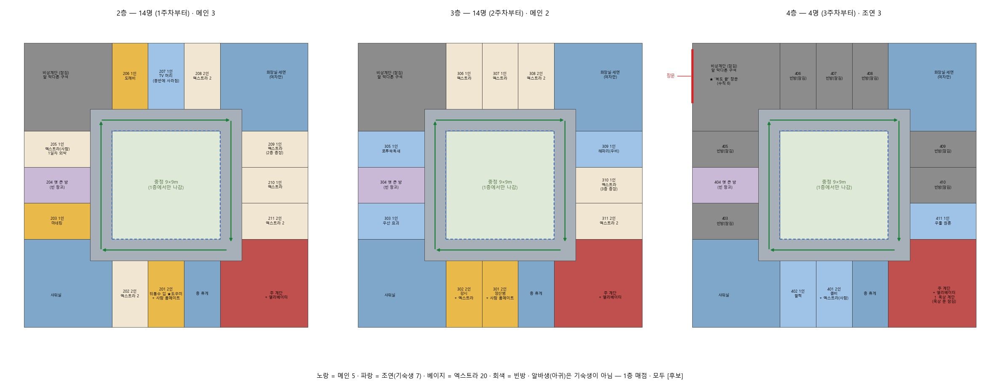

# 학생 정리 — 역할 · 층별 방 배정 (2026-11-28)

_사용자: "일단 학생들 먼저 구체적으로 정리하자. 편의점 알바생 하나랑, 사감 일 도와주는 학생 하나 — 1일차에 간단한 안내 진행 + 메인 캐릭터. 그 외에 층별로 몇 명 어디에 누굴 배치할지."_
_상태: 역할 틀(알바생 1 · 도우미 1 = 메인)은 [확정, 사용자]. 누가 맡는지·방 배정은 [후보]. 명단은 사용자 1차 선정 15명(`main5-picks-20261127.md` 2판), 메인 5는 그 문서의 **A′ 추천**(마네킹·뒤통수 입·장산범·강시·도깨비)으로 가정 — 사용자가 아직 A′/A″를 고르지 않음._
_건물: `building-layout.md` §17~§18 (2·3층 14명씩 · 4층 4명 · 합계 32명)._

## 1. 특별 역할 두 명

### 1-1. 사감 일 도와주는 학생 (도우미 · 사감실 근로장학생) — 메인 [역할 확정 · 누구는 후보]
- **추천: 뒤통수 입.** 낮엔 기숙사에서 **가장 사람 같고 친절한 아이** — 1일차에 열쇠를 건네고 사감실·매뉴얼 보관본을 알려 주는 안내역.
- 이유:
  1. 이 게임에서 가장 센 반전 "사람인 줄 알았는데"(main5 §2판)를 **가장 믿는 사람**에게 줌 → 반전의 무게가 가장 큼.
  2. 예전 추천 "근로장학생은 사람 기숙생"(plan §3-0-3)과 "메인에 사람 1명"(setting-bible §5-1 #7)이 부딪치던 문제가 풀림 — 모두가 사람인 줄 앎.
  3. 수칙 한 줄 "뒤돌아 서 있는 사람에게 말 걸지 말 것"이 **사감실 창구·서류 선반 앞에서 늘 등을 보이고 서 있는 도우미**와 바로 이어짐. 낮엔 그냥 일하는 뒷모습.
- 하는 일: 아침 업무 옆에서 거들기(택배 정리·서명부) · 소문 전하기 · 1일차 안내 · 사감실에 자주 있음(만나기 쉬움 = 친밀도가 쉽게 쌓임).
- 방: **201호(2인실, 주 계단 바로 옆)** + 사람 룸메이트(엑스트라). 룸메이트는 "그 애 앞얼굴을 정면으로 오래 본 적이 있나?" 같은 조각을 흘림 [후보].
- 다른 후보: **강시**(규칙을 좋아하는 모범생 — 도우미로 자연스러움, 반전은 약함) · **마네킹**(조용한 도우미 — 시선 공포가 사감실 안까지 들어옴).

### 1-2. 매점(편의점) 알바생 — 조연, 기숙생 아님 [역할 확정 · 누구는 후보]
- **추천: 아귀(초롱아귀).** 늘 배가 고픈 아이가 하필 편의점 알바 — 유통기한 지난 도시락을 챙겨 감, 머리 위 초롱불.
- 바깥(근처 자취방)에서 출근 → 건물 안에서 사감 말고 "여기 속하지 않는" 사람이 하나 더(building-layout §11-4).
- 밤: 셔터가 내려간 매점 안에서 **불빛 하나**(대표 변형 "어둠 속 이빨", ★불빛) · 셔터 메모 "밤에 자판기에서 같은 음료가 두 개 나오면 하나는 두고 가세요"를 쓴 사람.
- 매점 = 물건 사기 + 소문·단서 창구. 기숙생이 아니라 점호·방 배정에는 없음.
- 다른 후보: 이름 없는 **사람 알바생**(새로 만듦 — 안심 역할) · 포투쏙독새(밤에 강한 새, 야간 알바).

## 2. 전체 명단 — 32명 + 알바생
| 구분 | 수 | 누구 |
|---|---|---|
| 메인 | 5 | **뒤통수 입(도우미)** · 마네킹 · 도깨비 · 장산범 · 강시 |
| 조연 — 기숙생 | 7 | TV 머리(중반에 사라짐) · 우산 요괴 · 포투쏙독새 · 해파리(우비) · 좀비 · 팔척 · 우물 원혼 |
| 조연 — 바깥 사람 | 1 | 아귀(매점 알바생) |
| 엑스트라 | 20 | 사람 10 · 인외 10(공용 몸 + 부품. 고블린상어·아홀로틀은 여기 디자인 재료) — 이름은 나중에 |
| 합계 기숙생 | **32** | building-layout §18과 같음 |

### 2-1. 주연 5 [후보 — A′ 가정]
| 누구 | 방 · 역할 | 맡는 공포 | 수칙 한 줄 | 밤 대표 변형 (★남는 표지) | 처음 만남 |
|---|---|---|---|---|---|
| **뒤통수 입** | 201 · **도우미**(사감실 근로장학생) | 반전 — 낮엔 가장 사람 같음 | 뒤돌아 서 있는 사람에게 말 걸지 말 것 | 다른 곳의 입 (★헤어 집게) | 1일차 현관 — 열쇠를 건넴 |
| **마네킹** | 203 | 시선 — 안 볼 때 움직임 | 마네킹에서 눈을 떼지 말 것 | 이목구비 소실·관절 분리 (★빨간 립) | 1주차 2층 |
| **도깨비** | 206 | 대화 — 내기·씨름 제안, 지면 무언가를 가져감 | 도깨비의 내기에 응하지 말 것 | 거대·왜소 부조화 (★방망이) | 1일차 창구 — 2층 전등 민원 |
| **장산범** | 301 (+ 사람 룸메이트) | 소리 — 문 밖 룸메이트 목소리 | 문 밖 목소리에 대답하지 말 것 | 흉내 얼굴 (★빈티지 마이크) | 1일차 저녁 — 택배 찾으러 옴 |
| **강시** | 302 (+ 사람 룸메이트) | 점호 — 숨소리 하나 부족 | 강시 앞에선 숨을 참을 것 | 동태눈·굳은 몸 (★부적) | 1주차 1층 매점·휴게실 |
- 데모 2명: 마네킹 + 뒤통수 입 [후보] (main5 2판).

### 2-2. 조연 8 [후보]
| 누구 | 방 | 맡는 것 | 밤 대표 변형 (★) | 방에서 만나는 주 |
|---|---|---|---|---|
| **아귀**(초롱아귀) | — 매점 알바생, 기숙생 아님 | 물건 사기 · 소문·단서 창구 · 셔터 메모 | 어둠 속 이빨 (★불빛) | 1일차부터(매점) |
| TV 머리 | 207 | 휴게실 TV 담당 · **중반에 사라짐**(14일 전) → "207은 원래 비어 있었잖아요" | 흑백 노이즈·화면 속 실사 (★리본 안테나) | 1주차 |
| 우산 요괴 | 303 | 비 안 와도 우산 · 작은 사건 | 외눈·괴물 혀 (★우산 무늬) | 2주차 |
| 포투쏙독새 | 305 | 밤에 늘 깨어 있음 — 중정 창 너머로 보임 · 밤 목격담 | 큰 동공·꺾인 목 (★깃털 장식) | 2주차 |
| 해파리(우비) | 309 | 늘 젖은 투명 우비 · 샤워실·물 소문 | 속이 비침 (★우비 단추) | 2주차 |
| 좀비 | 401 (+ 사람 룸메이트) | "조용한 데가 좋아서" 4층에 삶 | 뼈·뒤틀림 (★분홍 카디건) | 3주차 |
| 팔척 | 402 | 창밖 — "창밖에서 불러도 창문을 열지 말 것" · 4층 막다른 창 | 늘어짐 (★모자 리본) | 3주차 |
| 우물 원혼 | 411 | 옥상 물탱크 바로 아래 · 머리카락에서 물이 안 마름 | 역방향 관절·머리카락 속 눈 (★흰 원피스) | 3주차 |
- 1~2주차에도 1층 공용 공간·엘리베이터·옥상 계단에서 스쳐 지나감(§4).

### 2-3. 엑스트라 20 — 사람 10 · 인외 10 [후보]
얼굴·이름은 나중에. 인외는 **공용 몸 + 부품 하나**(부품은 이름 있는 학생과 안 겹치게, 디자인은 아트에서). 번호 E01~E20은 문서용.
| 번호 | 방 | 사람/인외 | 하는 일 | 대사 |
|---|---|---|---|---|
| E01 | 201 | 사람 | 도우미 룸메이트 — "그 애 앞얼굴을 정면으로 오래 본 적 있나?" 조각 | **조금** |
| E02 | 202 | 사람 | | — |
| E03 | 202 | 인외 — 고블린상어 | 사용자 1차 명단, 엑스트라로 | 한두 줄 |
| E04 | 205 | 사람 | **1일차 외박** 튜토리얼(점호 때 조용해야 정상) | — |
| E05 | 208 | 인외 — 부품: 동물 귀·꼬리 | | — |
| E06 | 208 | 인외 — 부품: 작은 날개 | | — |
| E07 | 209 | 사람 | **2층 층장** — 점호 돕기 | **조금** |
| E08 | 210 | 인외 — 아홀로틀 | 사용자 1차 명단, 엑스트라로 | 한두 줄 |
| E09 | 211 | 사람 | | — |
| E10 | 211 | 인외 — 부품: 더듬이 | | — |
| E11 | 301 | 사람 | 장산범 룸메이트 — **흉내 낼 목소리의 주인** | **조금** |
| E12 | 302 | 사람 | 강시 룸메이트 — 점호 때 숨 쉬는 쪽 | 점호 대답만 |
| E13 | 306 | 인외 — 부품: 비늘 | | — |
| E14 | 307 | 사람 | | — |
| E15 | 308 | 인외 — 부품: 뿔 없는 짐승 귀(토끼형) | | — |
| E16 | 308 | 인외 — 부품: 이끼·버섯 머리 | | — |
| E17 | 310 | 인외 — 부품: 깃털 귀 | **3층 층장** | **조금** |
| E18 | 311 | 사람 | | — |
| E19 | 311 | 인외 — 부품: 돌 피부 | | — |
| E20 | 401 | 사람 | 좀비 룸메이트 — 왜 같이 사는지 말하지 않음 | **조금** |
- 층별: 2층 사람 5·인외 5 · 3층 사람 4·인외 5 · 4층 사람 1.
- 대사가 필요한 엑스트라는 **룸메이트 4명(E01·E11·E12·E20) + 층장 2명(E07·E17)**. 나머지는 점호 대답·복도 배경.

### 2-4. 명단 밖
- 빨간 마스크 · 뱀 · 문어 — 사용자 1차 명단(15명)에 없음 [폐기·대체]. 문어는 해파리(우비)로 합침.
- 전 사감 — 사람으로 나오지 않고 **일지·손글씨 조각으로만** [후보] (main5 1판 결정 4).

## 3. 층별 배정

_그림 스크립트: `tools/dev/cast_rooms.py`_

### 2층 — 14명 · 1주차부터 (메인 3 · 조연 1 · 엑스트라 10)
| 호 | 종류 | 누구 | 왜 여기 |
|---|---|---|---|
| 201 | 2인 | **뒤통수 입(도우미)** + 사람 룸메이트 | 주 계단 옆 = 사감실에서 가장 가까움. 룸메이트가 반전의 조각 |
| 202 | 2인 | 엑스트라 2 | |
| 203 | 1인 | **마네킹** | 옆이 204 옛 큰 방(빈 창고) — 쌓인 침대 틀·옛 캐비닛 사이에서 "볼 때마다 자세가 다름"이 잘 살아남. 데모 메인 |
| 204 | — | 옛 큰 방(빈 창고) | 원래 다른 건물 흔적 |
| 205 | 1인 | 엑스트라(사람) | 1일차 외박 튜토리얼(점호 때 조용해야 정상) |
| 206 | 1인 | **도깨비** | 1일차 "2층 복도 불이 깜빡여요" 민원을 가져오는 메인 A — 밝고 말 많은 첫 대화 |
| 207 | 1인 | TV 머리(조연) | 1주차부터 정이 들어야 중반에 **사라질 때** 아픔 → 사라진 뒤 "207은 원래 비어 있었잖아요"(game-flow §12-6 A) |
| 208 | 2인 | 엑스트라 2 | |
| 209 | 1인 | 엑스트라 — **2층 층장** | 점호를 돕는 기숙생(plan §3-0-3 자치회장 후보를 엑스트라 역할로) |
| 210 | 1인 | 엑스트라 | |
| 211 | 2인 | 엑스트라 2 | |

### 3층 — 14명 · 2주차부터 (메인 2 · 조연 3 · 엑스트라 9)
| 호 | 종류 | 누구 | 왜 여기 |
|---|---|---|---|
| 301 | 2인 | **장산범** + 사람 룸메이트 | 장치가 "문 밖에서 들리는 **룸메이트 목소리**" — 흉내 낼 진짜 목소리의 주인이 같은 방에 있어야 함 |
| 302 | 2인 | **강시** + 엑스트라 | 장치가 "점호 때 숨소리 하나 부족" — 2인실이라 대답은 둘인데 숨은 하나 |
| 303 | 1인 | 우산 요괴(조연) | |
| 304 | — | 옛 큰 방(빈 창고) | |
| 305 | 1인 | 포투쏙독새(조연) | 밤에 깨어 있는 새 — 중정 창 너머로 늘 깨어 있는 방 |
| 306~307 | 1인 | 엑스트라 | |
| 308 | 2인 | 엑스트라 2 | |
| 309 | 1인 | 해파리(우비)(조연) | 동쪽 날개 — 샤워실과 먼 쪽, 늘 젖은 우비 |
| 310 | 1인 | 엑스트라 — **3층 층장** | |
| 311 | 2인 | 엑스트라 2 | |
- 3층의 기숙생 규칙 "3층 복도 불이 혼자 꺼지면 다시 켜지 마"(plan §4-1)가 장산범·강시의 층에서 일어남.

### 4층 — 4명 · 3주차부터 (조연 3 · 엑스트라 1)
| 호 | 종류 | 누구 | 왜 여기 |
|---|---|---|---|
| 401 | 2인 | 좀비(조연) + 엑스트라(사람) | 주 계단 옆. "조용한 데가 좋아서" — 사람 룸메이트는 왜 같이 사는지 말하지 않음 |
| 402 | 1인 | 팔척(조연) | 키 때문에 문틀에 머리가 닿아 **천장 높은 옛 방**이 필요했다는 핑계 [후보] · 장치 "창밖에서 불러도 창문을 열지 말 것"이 4층 막다른 창문(수칙 6)과 이어짐 |
| 411 | 1인 | 우물 원혼(조연) | 계단탑·옥상 물탱크 바로 아래 — "머리카락에서 물이 안 마름" |
| 나머지 | — | 빈방(잠김) · 404 옛 큰 방 | 거의 빈 층 |
- 4층 셋은 모두 "사람이 피하는 층에 일부러 사는" 아이들 — 왜인지는 각자 사건에서 조각만.

## 4. 주차별로 만나는 사람
| 주 | 순찰·점호 열린 층 | 방에서 만나는 이름 있는 학생 | 그 밖(1층 공용 공간에서) |
|---|---|---|---|
| 1주차 | 1·2층 | 도우미(뒤통수 입) · 마네킹 · 도깨비 · TV 머리 | 장산범·강시 — 매점·휴게실·세탁실에서 먼저 얼굴을 익힘 · 알바생(아귀) |
| 2주차 | + 3층 | + 장산범 · 강시 · 우산 요괴 · 포투쏙독새 · 해파리 | 4층 셋은 엘리베이터·옥상 계단에서 스쳐 지나감 |
| 3주차 | + 4층·옥상 | + 좀비 · 팔척 · 우물 원혼 | — |
- 메인 5명 모두 **1주차에 얼굴을 봄**(3층 둘은 1층 공용 공간에서). 방 사건은 층이 열리는 주에 시작.

## 5. 1일차 대본(game-flow §14) 이름 맞추기 [후보]
| 대본 표기 | 누구 |
|---|---|
| 도우미 | 뒤통수 입 (201) |
| 알바생 | 아귀 |
| 메인 A — 2층 전등 민원 | 도깨비 (206) |
| 메인 B — 저녁에 택배 찾으러 옴 | 장산범 (301) — 3층 사람을 1일차에 먼저 보여 줌 |
| 205 외박 | 엑스트라(사람) |

## 6. 확인할 것
1. 메인 5 = **A′(도깨비)** 그대로 갈지, **A″(팔척)**로 바꿀지 — A″면 팔척이 4층(3주차)이라 메인인데 방에서 늦게 만남 → A′ 추천.
2. 도우미 = **뒤통수 입** (추천) / 강시 / 마네킹
3. 알바생 = **아귀** (추천) / 사람 알바생 / 포투쏙독새
4. 엑스트라 20명은 사람 10 · 인외 10, 이름·얼굴은 나중에(공용 몸) — 층장 2명(209·310)·룸메이트 4명(201·301·302·401)만 먼저 대사 몇 줄(§2-3).

## 7. 매력 두 겹 — 연애 × 공포 (2026-11-28)
_사용자: "연애로도 매력이 있고 공포 쪽으로도 매력이 있어야 해." → 모든 주연·조연의 기준 [확정, 사용자]. 아래 내용은 [후보]._
_성격·학과는 예전 설정을 이어받음(`cast-school-20261121.md`·`redesign-27-20261125.md`). 밤 변형은 `night-mutation-cast-20261127.md` §3._

### 7-1. 만드는 원칙 [후보]
1. **한 특징, 두 얼굴** — 낮에 설레게 하는 바로 그 특징이 밤에 무서운 것이 됨. 연애 매력과 공포 매력을 따로 붙이지 않음.
2. **가까워질수록 더 무서움** — 호감이 오르면 그 아이가 더 많은 것을 보여 줌 → 밤에 보는 것도 더 깊어짐. 무서운 모습을 들킨 뒤에도 그 아이는 숨기려 하고 상처받음(괴물이 아니라 "들키고 싶지 않은 사람").
3. **연애가 곧 생존 단서** — 친밀도가 오르면 그 아이가 직접 "밤에 나를 보면 이렇게 해"를 흘림 = 개체별 대처 힌트(plan §4-2-2)의 한 출처. 단, 이 말도 늘 맞지는 않음(§4-2-1 세 출처).
4. **낮의 약점 ↔ 밤의 위협이 짝** — 낮에 챙겨 주고 싶은 빈틈(추위·배고픔·자신 없음)이 밤에 그 아이를 위험하게 만드는 것과 같은 뿌리.

### 7-2. 주연 5 — 연애 루트 있음
| 누구 | 낮 연애 매력 | 밤 공포 매력 | 둘을 잇는 한 줄 | 호감이 오르면 |
|---|---|---|---|---|
| **뒤통수 입**(도우미, 식품영양학과 2) | 기숙사에서 가장 다정한 안내자. 소식좌라 자기 몫을 늘 나눠 줌 · 일 끝나고 같이 야식 · 일할 땐 늘 등을 보이고 서 있음 | 정면을 오래 보여 주지 않음 · 머리카락이 숨 쉬듯 들썩 · 냉장고 음식이 사라짐 | **자기는 안 먹고 다 나눠 주는 아이 — 먹는 입은 따로 있음** | 등 뒤 헤어 집게를 고쳐 달라고 부탁함(가장 친밀한 장면) ↔ 수칙 "뒤돌아 선 사람에게 말 걸지 말 것"과 정면으로 부딪침 — 믿을까, 수칙을 지킬까 |
| **마네킹**(뷰티디자인학과 1) | 매일 아침 얼굴을 직접 그리는 아이. "오늘 얼굴 어때?"라고 물어 옴 · 맨얼굴을 부끄러워함 | 안 볼 때 자세가 바뀜 · 밤엔 화장이 지워진 매끈한 빈 얼굴 | **"봐 줬으면" 하는 아이 — 눈을 떼면 움직이는 아이** | 플레이어 취향으로 화장을 바꿈 · "눈 떼지 마"가 고백처럼 들림 → 수칙과 같은 말 |
| **도깨비**(경영학과 3) | 밝고 말 많은 장사꾼. 사소한 내기·흥정을 걸어 오는 놀이 같은 대화 · 이기면 선물, 지면 간식 하나 | 밤의 내기는 진짜를 가져감(물건 → 기억 → 이름) | **낮의 장난 내기 = 밤의 계약** | 직접 "나랑은 밤에 내기하지 마"라고 경고 — 그 경고마저 내기일 수 있음 |
| **장산범**(방송연예학과 성우 2) | 남의 목소리를 똑같이 해내는 성우 지망생. 플레이어가 좋아하는 목소리로 책을 읽어 줌 · 녹음 연습 상대 | 문 밖에서 아는 사람 목소리 · 입 모양이 늦게 맞음 | **네 목소리를 좋아해 → 네 목소리를 가져감** | 플레이어 목소리를 흉내 내기 시작함(달콤함과 위험이 같이 오름) — 끝에는 문 밖에서 **내 목소리**가 나를 부름 |
| **강시**(한의학과 4) | 규칙을 좋아하는 차가운 모범생 선배. 맥을 짚어 주고 약차를 챙겨 줌 · 자기 손은 늘 차가움 | 점호 때 숨소리가 하나 부족 · 앞에서 숨을 참아야 함 · 굳은 몸 | **맥을 짚어 주는 손에 맥이 없음** | "숨 오래 참기" 내기를 같이 함(귀여운 장면 = 수칙 연습) · 핫팩을 쥐여 주면 처음으로 웃음 |

### 7-3. 조연 8 — 가벼운 호감(짧은 이벤트), 연애 루트는 없음 [후보]
| 누구 | 낮 매력 | 밤 공포 | 한 줄 |
|---|---|---|---|
| 아귀(매점 알바생) | 유통기한 지난 도시락을 몰래 챙겨 주는 야간 알바 · 밤샘 방송 | 셔터 안 불빛 하나, 어둠 속 이빨 | 늘 배고픈 아이가 남을 먹임 |
| TV 머리(207) | 기분이 화면에 다 나오는 방송부 — 거짓말을 못 함 | 화면 속 얼굴이 늦게 따라봄 · 다른 사람 얼굴 | 가장 솔직한 아이가 **사라짐** — 정든 만큼 아픔 |
| 우산 요괴(303, 대기과학과 3) | 비 오는 날에만 밖에 나감 · 우산을 같이 씀 | 우산 그늘 속 큰 외눈 | 같이 쓰는 우산 아래가 가장 가까운 자리 |
| 포투쏙독새(305, 문헌정보학과 4) | 낮엔 도서관에서 나뭇가지처럼 졺 · 밤엔 유일하게 깨어 있는 말동무 | 목이 꺾인 채 정면 · 동공이 눈을 덮음 | 밤에 깨어 있는 유일한 친구 = 밤의 목격자 |
| 해파리 우비(309, 심리학과 1) | 기분이 몸에 다 비쳐서 숨기지 못함 · 남의 마음을 공부함 | 몸속에 작은 그림자가 떠다님 | 다 비치는 아이 속에 나도 모르는 것이 있음 |
| 좀비(401, 간호학과 3) | 꿰맨 자리마다 꽃이 핌 · 다친 곳에 붕대를 감아 줌 | 뒤로 꺾여 네 다리로 걸음 | 남을 꿰매 주는 아이의 실밥이 터짐 |
| 팔척(402) | 키가 커서 늘 모자로 얼굴을 가리는 수줍음 · 문틀에 머리를 박음 | 창밖에서 아는 목소리로 부름 · 늘어나는 몸 | 몸을 숨기려는 아이가 창밖에서 다 보임 |
| 우물 원혼(411) | 머리카락이 안 말라 드라이기를 빌리러 옴 · 말수 적음 | 무릎이 거꾸로 꺾인 채 기어 옴 | 젖은 머리를 말려 주고 싶은 아이 — 그 물은 어디서 오나 |
- 조연도 같은 원칙(한 특징 두 얼굴)을 지킴. 조연 중 하나를 루트로 올릴지는 [보류].
- 엑스트라는 연애 대상이 아님. 층장·룸메이트만 성격 한 줄.

### 7-4. 확인할 것
1. 원칙 3 "연애가 곧 생존 단서"를 게임 규칙으로 넣을지 — 넣으면 낮 미연시가 밤 공략과 바로 이어짐 [추천].
2. 연애 루트는 주연 5만 (조연은 짧은 이벤트) [추천].

## 8. 주연 다시 정하기 — 연애 × 공포 기준 (2026-11-28, 사용자: "주연 다시 정해 봐") [후보]
_기준: §7 "연애로도 공포로도 매력" [확정] + 기숙사 공포 장치가 겹치지 않음. **바뀐 조건**: 캐릭터가 종이인형극 빌보드(tech-plan §5-5-5)라 "3D로 만들기 쉬움·특수 몸 1명 이하"(main5 기준 4)는 거의 의미가 없어짐 → 큰 키·기어 오는 몸도 그림 카드면 됨._

### 8-1. 15명 다시 보기
| 누구 | 연애 | 공포 | 맡을 장치 | 판정 |
|---|---|---|---|---|
| 마네킹 | ◎ "봐 줘" · 화장 | ◎ 안 볼 때 움직임 | 시선(순찰) | **주연** |
| 뒤통수 입 | ◎ 가장 다정한 도우미 | ◎ 가장 센 반전 | 반전 | **주연(도우미)** |
| 장산범 | ○ 목소리로 읽어 주는 성우 지망생 | ◎ 문 밖 룸메이트 목소리 = 기숙사 공포 그 자체 | 소리 | **주연** |
| 강시 | ○ 차가운 선배 + 맥 짚어 주는 갭 | ○ 점호 때 숨 하나 부족 · 숨 참기 행동 | 점호 | **주연** |
| **팔척** | ◎ 큰 키를 부끄러워하는 수줍은 아이 — 서브컬처에서 가장 인기 있는 갭 중 하나 | ◎ 가장 유명한 괴담 · 2층 창밖에 모자 챙 | **높이**(창·천장) | **주연으로 올림** |
| 도깨비 | ◎ 밝은 장사꾼 · 내기 | △ 내기는 무섭다기보다 꾀 — 예전에도 공포 장치 약함 판정 | 대화(내기) | 조연으로 내림 |
| TV 머리 | ○ 거짓말 못 하는 방송부 | ○ 화면 속 다른 얼굴 | 사라짐 | 조연(중반에 사라지는 역이 더 중요) |
| 아홀로틀 | ◎ 귀여움·팬아트 인기 | ○ 그림 공포(재생 과다)는 세나 기숙사 장치가 약함 | — | 조연 후보(엑스트라 → 올릴지 [확인 필요]) |
| 우물 원혼 | △ 말수 적음 | ◎ 기어 옴 | 기어 옴 | 조연(팔척과 "긴 흑발 귀신" 겹침) |
| 포투쏙독새 · 좀비 · 해파리 우비 · 우산 요괴 | ○ | ○~△ | 작은 사건 | 조연 |
| 아귀 | ○ | ○ | 매점 | 알바생 |
| 고블린상어 | △ | ○ | — | 엑스트라 |

### 8-2. 새 주연 5 추천 — "도깨비 → 팔척"
| 주연 | 장치 | 낮 연애 | 밤 공포 | 한 줄 | 호감이 오르면 |
|---|---|---|---|---|---|
| 뒤통수 입(도우미) | 반전 | (§7-2 그대로) | | | |
| 마네킹 | 시선 | (§7-2 그대로) | | | |
| 장산범 | 소리 | (§7-2 그대로) | | | |
| 강시 | 점호 | (§7-2 그대로) | | | |
| **팔척** | **높이** — 2층 창 위로 모자 챙이 보임 · 천장에 모자가 눌려 고개를 꺾음 · "포포포" | 키를 부끄러워해 늘 몸을 웅크리고 모자를 깊게 씀 · 문틀·형광등에 머리를 박음 · 사감을 내려다보며 말하는 걸 미안해함 | 창밖·천장 높이에서 내려다봄 · 몸이 늘어남 | **몸을 숨기려 웅크리는 아이 — 밤엔 다 펴짐** | 플레이어 앞에서만 허리를 펴고 섬(가장 친밀한 장면) = 밤에 늘어나는 몸짓과 같음 |
- 다섯 장치: 시선 · 반전 · 소리 · 점호 · 높이 — 안 겹침. 팔척은 **보이는 것(높이)**만 맡고 "아는 목소리"는 장산범에게만 줌(예전 A″의 겹침 풀기).
- 잃는 것: 도깨비의 "대화 선택지 공포". 대신 뒤통수 입 딜레마(§7-2)와 "연애가 생존 단서"(§7-1 원칙 3)가 연애와 공포를 이어 줌.
- 방: **팔척 → 206(2층)**, 도깨비 → 402(4층, "빈방을 창고로 쓰려는 장사꾼"). 2층이어야 "2층 창밖의 모자 챙"이 됨.
- 1일차: 메인 A의 2층 전등 민원 → **팔척이 복도 형광등에 머리를 박아 깨뜨림** — 첫 만남이 귀엽고, 키를 미리 알려 줌.
- 걸리는 점: 팔척(흰 원피스·모자)과 장산범(흰 털·흰 코트)이 **흰색 겹침** → 팔척 팔레트를 바꿀지 아트에서 [확인 필요].

### 8-3. 다른 안
- **그대로(A′)**: 도깨비 유지 — 낮이 가장 밝지만 공포가 약함.
- **강시 대신 아홀로틀**: 연애는 더 세지지만 점호 장치가 빠짐 → 추천 안 함.
- 확정하면 §2·§3·§5·§7·그림(`cast_rooms.png`)·1일차 대본(game-flow §14)을 같이 바꿈.
